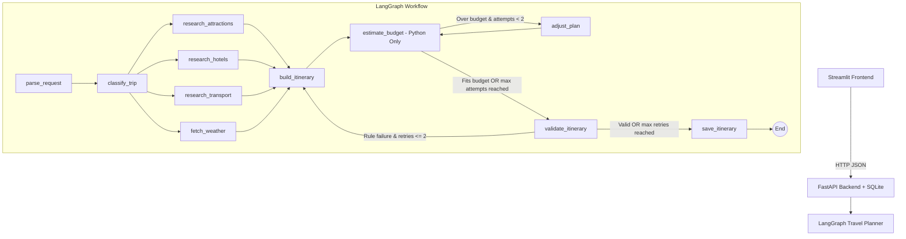

# Architecture, Scope & Workflow Design

## 1. Chosen Use Case (Single Focused Scope)
**Budget Travel Planner** *(Primary Scenario: Two college friends planning a 4-day trip to Goa with a total budget of ₹20,000 INR)*

The user submits a destination, optional origin city, travel dates, total budget, traveller counts (adults & children), preferences, and constraints. The AI Travel Planning Agent researches real attractions, affordable stays, and transportation options via web search, checks destination weather via Open-Meteo, selects and organizes a budget-friendly day-wise itinerary using LangGraph, calculates all expenses deterministically in Python (never by the LLM), adjusts the plan if it exceeds the budget, validates the final itinerary, and persists both requests and generated itineraries in SQLite.

> **Important Scope Boundary:** The agent **only plans trips**; it does **not** perform bookings, reservations, or payments.

---

## 2. Inputs & Outputs

### Inputs (`TripRequestCreate`)
| Field | Type | Validation Rules |
|---|---|---|
| `destination` | `str` | Required, non-empty (e.g., `"Goa, India"`) |
| `origin` | `str` (optional) | Starting city for intercity transport context (e.g., `"Pune, India"`) |
| `start_date` | `date` | Cannot be in the past (`>= today`) |
| `end_date` | `date` | Must be strictly after `start_date` (`> start_date`) |
| `budget` | `float` | Must be `> 0` (e.g., `20000`) |
| `currency` | `str` | Default `"USD"`; supports `"INR"`, `"USD"`, `"EUR"`, `"GBP"` |
| `adults` | `int` | Must be `>= 1` (e.g., `2`) |
| `children` | `int` | Must be `>= 0` |
| `preferences` | `list[str]` | Interests (e.g., `beaches`, `hostels`, `street food`, `budget travel`) |
| `constraints` | `list[str]` | Hard rules (e.g., `vegetarian`, `no late nights`) |

### Output (`Itinerary`)
- `trip_type`: `"budget" | "family" | "adventure"`
- `weather_report`: Availability flag, coordinates, daily min/max temperatures, precipitation probability, weather summary
- `selected_hotel`: Name, price per night (or `None` + estimated flag), source URL
- `selected_transport`: Mode/route, price (or `None` + estimated flag), source URL
- `days`: Ordered list of `DayPlan` items, each containing date, weather note, `rain_backup`, `is_buffer_day`, and `TimedActivity` entries
- `cost_breakdown`: Deterministic Python calculation of `stay`, `transport`, `local_travel`, `food`, `activities`, and `buffer` costs, total cost, remaining/over-budget amount, and `fits_budget` boolean
- `assumptions`: Explicit list of estimation assumptions
- `budget_warning`: Clear message showing how much the plan is over budget when it cannot fit
- `validation`: Pass/fail status and any rule errors/warnings
- `disclaimer`: `"Planning only — this agent does not book hotels, transport, or tickets."`

---

## 3. Budget Formula & Selection Rules (Deterministic Python Only)

All arithmetic and selection heuristics live in `app/budget.py`:

Let:
- `nights = (end_date - start_date).days`
- `total_days = nights + 1` (e.g., 3 nights / 4 days for a 4-day Goa trip)
- `rooms_needed = max(1, ceil((adults + 0.5 * children) / 2))`
- `activity_travellers = adults + 0.5 * children`
- `transport_travellers = adults + 0.75 * children`
- `scale = CURRENCY_FALLBACK_MULTIPLIER[currency]` (`USD: 1.0`, `EUR: 1.0`, `GBP: 0.85`, `INR: 20.0`)

1. **Stay (`hotel_cost`)**:
   - Uses `hotel.price_per_night` if found in search; otherwise uses trip-type fallback nightly rate (`budget: 60 * scale`, i.e., `₹1,200/night` for INR) and marks `is_estimated = True`.
   - `hotel_cost = round(nightly_rate * rooms_needed * nights, 2)`

2. **Transport (`transport_cost`)**:
   - Uses `transport.price_per_person` if found in search; otherwise uses trip-type fallback rate (`budget: 80 * scale`, i.e., `₹1,600/person` for INR) and marks `is_estimated = True`.
   - `transport_cost = round(unit_transport_price * transport_travellers, 2)`

3. **Local Travel (`local_travel_cost`)** (always marked `is_estimated = True`):
   - Daily rate (`budget: 10 * scale`, i.e., `₹200/day/person` for INR) × `activity_travellers` × `total_days`.

4. **Food (`food_cost`)** (always marked `is_estimated = True`):
   - Daily rate (`budget: 25 * scale`, i.e., `₹500/day/person` for INR) × `activity_travellers` × `total_days`.

5. **Activities (`activities_cost`)**:
   - Uses `activity.unit_price` if found in search; free categories (`park`, `beach`, `walking`, etc.) resolve to `0`; missing paid prices use category fallbacks (`general: 20 * scale`, i.e., `₹400` for INR) and mark `is_estimated = True`.
   - `activities_cost = round(sum(effective_unit_price * activity_travellers), 2)`

6. **Contingency Buffer (`buffer_cost`)** (always marked `is_estimated = True`):
   - `subtotal * buffer_rate` where `buffer_rate` is `5%` (`budget`) or `10%` (`family`, `adventure`).

7. **Totals**:
   - `total_cost = round(subtotal + buffer_cost, 2)`
   - `remaining_budget = round(budget - total_cost, 2)`
   - `over_budget_amount = round(max(0.0, total_cost - budget), 2)`
   - `fits_budget = total_cost <= budget`

---

## 4. LangGraph Workflow & Validation Rules

### Validation Rules (`validate_itinerary`)
- **All trips:** Exact day count (`nights + 1`), consecutive dates, non-empty daily activities, every activity comes from researched candidates with valid `source_url`, and clear budget warnings when `total_cost > budget`.
- **Family:** Maximum 3 main activities per day AND every day includes a non-empty `rain_backup`.
- **Adventure:** No forbidden night travel (`21:00`–`04:59`, `night bus`, `overnight`, `red-eye`) AND at least one designated `is_buffer_day` for trips of 3+ days.
