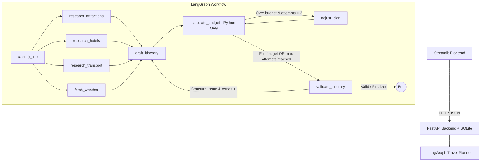

# Architecture, Scope & Workflow Design

## 1. Chosen Use Case (Single Focused Scope)
**Personalised Multi-Day Leisure Trip Planner (`budget`, `family`, or `adventure`)**

The user submits a destination, optional origin city, travel dates, total budget, traveller counts (adults & children), preferences, and constraints. The AI Travel Planning Agent researches real attractions, hotels, and transportation options via web search, checks destination weather via Open-Meteo, selects and organizes a personalised day-wise itinerary using LangGraph, calculates all costs deterministically in Python (never by the LLM), adjusts the plan if it exceeds the budget, validates the final itinerary, and persists both requests and generated itineraries in SQLite.

> **Important Scope Boundary:** The agent **only plans trips**; it does **not** perform bookings, reservations, or payments.

---

## 2. Inputs & Outputs

### Inputs (`TripRequestCreate`)
| Field | Type | Validation Rules |
|---|---|---|
| `destination` | `str` | Required, non-empty |
| `origin` | `str` (optional) | Starting city for intercity transport context |
| `start_date` | `date` | Cannot be in the past (`>= today`) |
| `end_date` | `date` | Must be strictly after `start_date` (`> start_date`) |
| `budget` | `float` | Must be `> 0` |
| `currency` | `str` | Default `"USD"` (e.g., `"USD"`, `"EUR"`, `"INR"`) |
| `adults` | `int` | Must be `>= 1` |
| `children` | `int` | Must be `>= 0` |
| `preferences` | `list[str]` | Interests (e.g., `museums`, `local food`, `hiking`) |
| `constraints` | `list[str]` | Hard rules (e.g., `vegetarian`, `no late nights`, `wheelchair accessible`) |

### Output (`ItineraryResponse`)
- `trip_type`: `"budget" | "family" | "adventure"`
- `weather_report`: Availability flag, coordinates, daily min/max temperatures, precipitation probability, weather summary
- `selected_hotel`: Name, price per night (or `None` + estimated flag), source URL
- `selected_transport`: Mode/route, price (or `None` + estimated flag), source URL
- `days`: Ordered list of `DayPlan` items, each containing date, weather note, and `TimedActivity` entries (time slot, title, category, description, source URL, ticket price / estimated flag)
- `cost_breakdown`: Deterministic Python calculation of accommodation, transport, activities, meals/local transit buffer, total cost, remaining/over-budget amount, and `fits_budget` boolean
- `assumptions`: Explicit list of estimation assumptions (e.g., fallback prices used when search did not report a price)
- `budget_warning`: Clear message whenever the plan cannot fit within budget even after adjustment loops
- `validation`: Pass/fail status and any warnings
- `disclaimer`: `"Planning only — this agent does not book hotels, transport, or tickets."`

---

## 3. Budget Formula & Assumptions (Deterministic Python Only)

All arithmetic runs in `app/budget.py`:

Let:
- `nights = (end_date - start_date).days`
- `total_days = nights + 1`
- `rooms_needed = max(1, ceil((adults + 0.5 * children) / 2))`
- `equivalent_travellers = adults + 0.5 * children`

1. **Accommodation Cost**:
   - Uses `hotel.price_per_night` if found in search; otherwise uses trip-type fallback nightly rate (`budget: 60`, `family: 130`, `adventure: 95` in currency units) and marks `is_estimated = True`.
   - `hotel_cost = round(nightly_rate * rooms_needed * nights, 2)`

2. **Transportation Cost**:
   - Uses `transport.price_per_person` if found in search; otherwise uses trip-type fallback round-trip rate (`budget: 80`, `family: 140`, `adventure: 120`) and marks `is_estimated = True`.
   - `transport_cost = round(unit_transport_price * (adults + 0.75 * children), 2)`

3. **Activities Cost**:
   - For each scheduled activity in the itinerary:
     - Uses `activity.price_per_person` if found in search; if `None` and activity is paid/ticketed, applies category fallback (`0` for parks/walks/free markets, `20` for museums/tours/adventure) and marks `is_estimated = True`.
   - `activities_cost = round(sum(act_price * (adults + 0.5 * children)), 2)`

4. **Daily Meals & Local Transit Allowance** (always marked `is_estimated = True`):
   - Per-person-per-day allowance by trip type (`budget: 35`, `family: 55`, `adventure: 45`).
   - `meals_local_cost = round(daily_allowance * equivalent_travellers * total_days, 2)`

5. **Total & Budget Check**:
   - `total_cost = round(hotel_cost + transport_cost + activities_cost + meals_local_cost, 2)`
   - `remaining_budget = round(budget - total_cost, 2)`
   - `over_budget_amount = round(max(0.0, total_cost - budget), 2)`
   - `fits_budget = total_cost <= budget`

---

## 4. LangGraph Workflow & System Architecture

